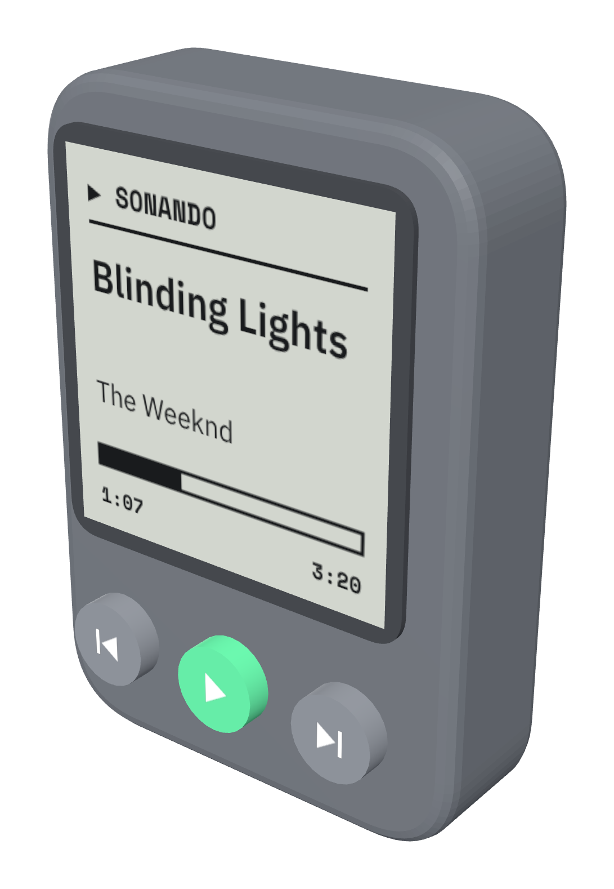
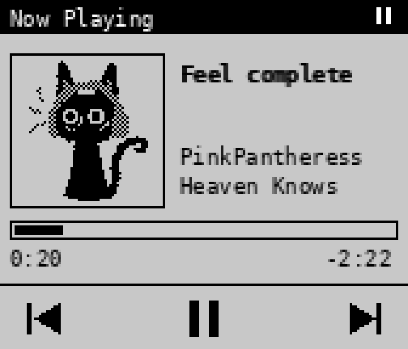
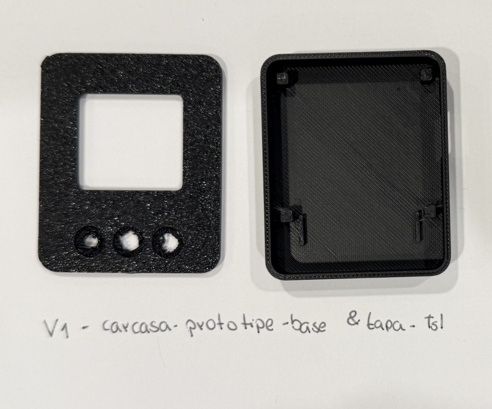
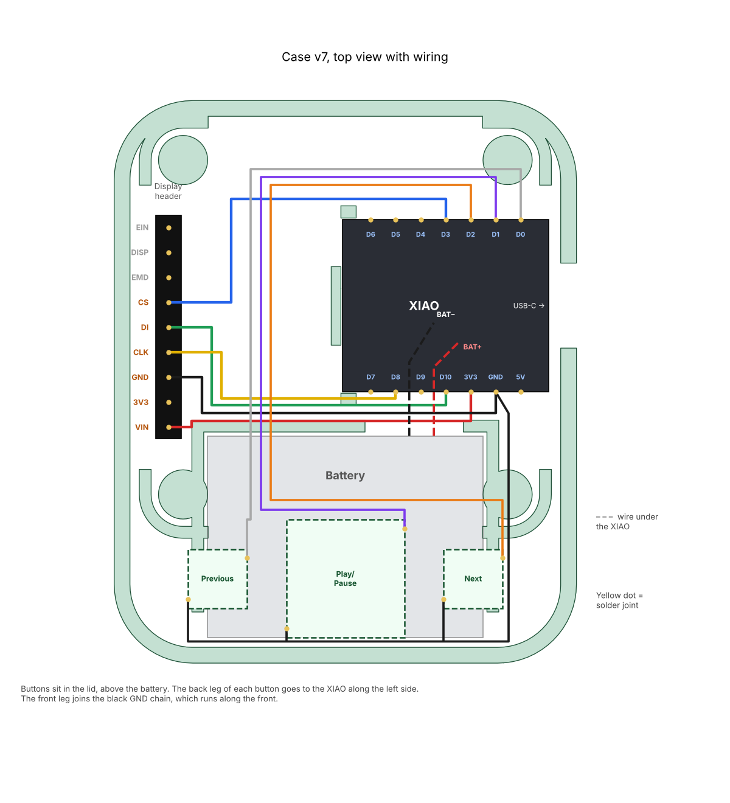

# Mini Mando: a tiny Spotify remote for iPhone

A small Bluetooth remote with a low-power screen that shows what is playing on my iPhone and lets me play/pause and skip songs. It is my first hardware project, built from scratch: choosing parts, breadboarding, writing firmware, designing and 3D-printing seven case iterations, and finally designing a custom PCB.

<p align="center">
  
  &nbsp;&nbsp;
  
</p>

## What it does

- Shows the **song title, artist, album, progress bar and battery level** on a 1.3" Sharp Memory LCD (readable in sunlight, almost zero power).
- Three buttons: **previous, play/pause, next**.
- Talks to the iPhone over **Bluetooth Low Energy using Apple Media Service (AMS)**, which is built into every iPhone. That means **no app, no Wi-Fi and no Spotify Premium**: it works with whatever is playing, Spotify included.
- Runs on a 150 mAh LiPo, charged over USB-C.

## How it works

```
iPhone (Spotify)  --BLE / Apple Media Service-->  XIAO nRF52840  --SPI-->  Sharp Memory LCD 144x168
                  <--play/pause, next, previous--        ^
                                                         |
                                              3 buttons (D0, D1, D2)
```

The XIAO nRF52840 pairs with the phone as a BLE peripheral, subscribes to AMS for track info and playback state, and sends remote commands back when a button is pressed. Wi-Fi + the Spotify Web API was ruled out early because the battery would only last a few hours.

## The process

| Date (2026) | Step |
|---|---|
| Oct 28 | Idea: a mini screen next to the camera of my iPhone 16 Pro. Picked parts, ordered them, printed a 26 x 38 x 9 mm **size test block**. |
| Oct 29 | **Simulated** the circuit in Wokwi while waiting for parts (custom chip that imitates the Sharp display). |
| Oct 30 | Printed **case v1**, fixed button holes and the loose lid in **v2**. |
| Oct 31 | Parts arrived. **Hardware test** on the breadboard, then the **first working Bluetooth connection**: song info on screen, buttons control Spotify. Case **v3** and **v4** (raised square buttons, big play button). |
| Nov 1 | Case **v5** and **v6** (display corner posts with pins). Redesigned the screen **iPod-style** with a pixel-art cat as "album art" and a battery icon. |
| Nov 2 | Case **v7**: snap-fit for the XIAO, battery pocket, exact USB-C opening, rounder corners, printable button caps. |
| Nov 3-4 | Soldering inside the case with breadboard wires was too hard, so I designed a **custom PCB (v0.1)** that replaces all wires. |

Full details, with what went wrong and what I changed each time: **[docs/iteration-log.md](docs/iteration-log.md)**.

<p align="center">
  
  &nbsp;
  
</p>

## Repository layout

| Folder | Contents |
|---|---|
| [`firmware/`](firmware/) | Arduino sketches. `mini_mando` is the main firmware (Sharp LCD). `hardware_test` checks display and buttons without Bluetooth. `mini_mando_oled` and `mini_mando_eink` are variants for cheaper screens. |
| [`hardware/case/`](hardware/case/) | Every case iteration (v0 size test to v7) as STL/3MF. v7 includes the Python script that generates it. |
| [`hardware/pcb/v0.1/`](hardware/pcb/v0.1/) | Custom PCB: Gerbers for JLCPCB/AISLER, preview, 1:1 paper template and the Python generator. |
| [`simulation/`](simulation/) | Wokwi simulation, for the browser and for VS Code + PlatformIO. |
| [`keychain/`](keychain/) | Side project: decorative keychains inspired by the remote. |
| [`media/`](media/) | Renders, photos of the prints and the 3D model of the remote ([`media/3d/remote.glb`](media/3d/remote.glb), viewable with [`media/3d/viewer.html`](media/3d/viewer.html)). |
| [`docs/`](docs/) | Iteration log, bill of materials, wiring. |

## Build it yourself

1. Get the parts in the **[bill of materials](docs/bom.md)**.
2. Wire it on a breadboard following **[docs/wiring.md](docs/wiring.md)**.
3. Install Arduino IDE, add the Seeed board URL `https://files.seeedstudio.com/arduino/package_seeeduino_boards_index.json`, install **Seeed nRF52 Boards** (not the mbed one) and the **Adafruit SHARP Memory Display** library.
4. Upload `firmware/hardware_test` first. When the display and all three buttons work, upload `firmware/mini_mando`.
5. Pair: open Spotify, then pair "Mini Mando" from the iPhone (if it does not show in Settings > Bluetooth, connect once with the free **nRF Connect** app and accept the pairing prompt).
6. Print the latest case from `hardware/case/v7` (PLA, 0.2 mm layers, 20 % infill, no supports).

## Status and next steps

- [x] Working prototype on the breadboard (display, buttons, Bluetooth, battery reading)
- [x] Printed prototype case (v7)
- [x] PCB v0.1 designed, waiting to be checked with the 1:1 template before ordering
- [ ] Slim version (about 26 x 38 x 11 mm) next to the camera, using the bare Sharp panel and a 10-pin 0.5 mm FPC adapter
- [ ] Flatter buttons for the final version
- [ ] Real album art (would need a companion iOS app, since AMS only sends text)

## Lessons learned

- **Simulate while you wait for parts.** Wokwi let me test the display code before anything arrived.
- **Test hardware without Bluetooth first.** A simple display + button test found a GND rail that was not connected and a button inserted the wrong way.
- **Breadboard jumper wires are the wrong tool inside a small case.** Use thin silicone wire (28-30 AWG), solder outside the case, or better, make a PCB.
- **Design for the printer.** Overhangs around the button holes printed badly in v1; holes and ledges were redesigned to print face down.
- **Look up real dimensions.** The display board size came from Adafruit's published design files, which made the snap-fit posts fit first time.

## License

Firmware and scripts: [MIT](LICENSE). Case, PCB and keychain designs: [CC BY 4.0](https://creativecommons.org/licenses/by/4.0/).
