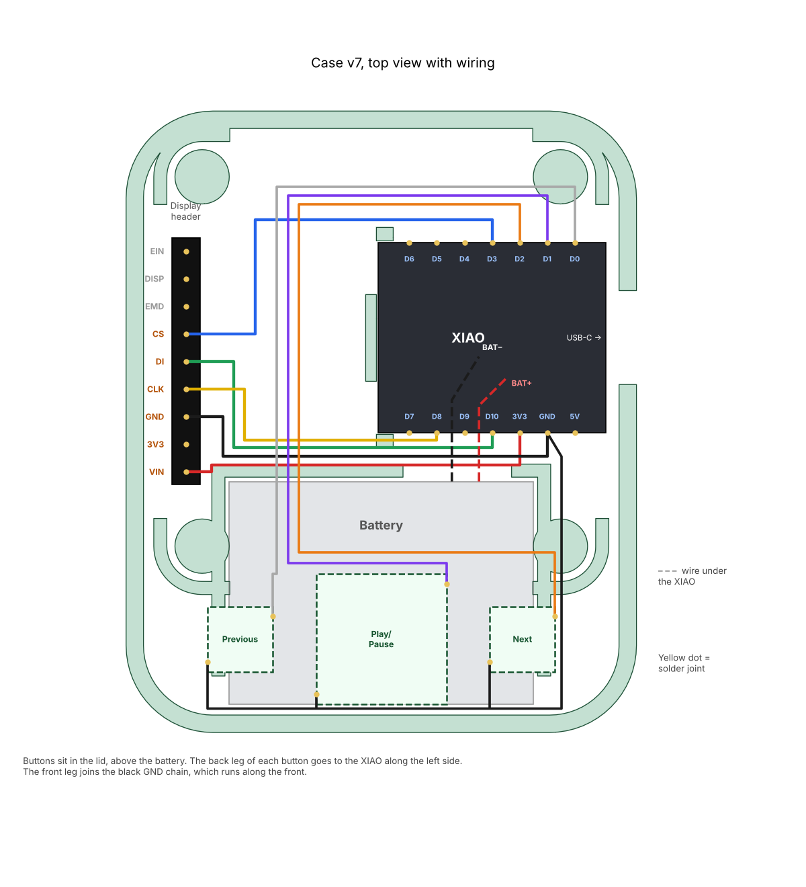

# Wiring

Main build: Seeed XIAO nRF52840 + Adafruit Sharp Memory Display + 3 tactile switches.

| XIAO pin | Goes to | Wire color used |
|---|---|---|
| 3V3 | Display VIN | red |
| GND | Display GND | black |
| D8 (SCK) | Display CLK | yellow |
| D10 (MOSI) | Display DI | green |
| D3 | Display CS | blue |
| D0 | Previous button | orange |
| D1 | Play/pause button | purple |
| D2 | Next button | light blue |
| GND | Other leg of all 3 buttons (chained) | black |
| BAT+ / BAT- (pads under the board) | LiPo red / black | red / black |

The display's 3V3, EMD, DISP and EIN pins stay unconnected. Buttons use the internal pull-ups, so no resistors are needed.

> On a breadboard, make sure the GND rail the buttons use is actually connected to the XIAO's GND. That was my first bug.

> On **PCB v0.1** previous and next are swapped: previous is **D2** and next is **D0**.

## Variants

**OLED (`firmware/mini_mando_oled`):** SDA -> D4, SCL -> D5, VCC -> 3V3, GND -> GND. Check the VCC/GND order on your module.

**E-paper (`firmware/mini_mando_eink`):** VCC -> 3V3, GND -> GND, CLK -> D8, DIN -> D10, CS -> D3, DC -> D4, RST -> D5, BUSY -> D6.

Buttons are the same in all variants: D0, D1, D2 to GND.
